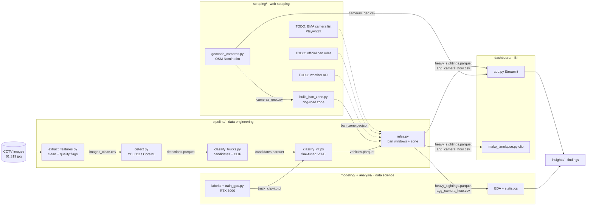

# Architecture

How the four required components and web scraping connect. Boxes are folders; arrows are files in `data_out/`
(the contracts between stages — keep their columns stable).

## Data contracts (`data_out/`)

| File | Producer | Consumers | Key columns |
|---|---|---|---|
| `images_clean.csv` | `pipeline/extract_features.py` + EDA | detect, rules, clip | `path, camera_id, timestamp, very_dark, invalid…` |
| `detections.parquet` | `pipeline/detect.py` | classify | `path, camera_id, timestamp, cls, conf, x1..y2` |
| `candidates.parquet` | `pipeline/classify_trucks.py embed` | classify_vit, modeling | detection cols + `zs_*` |
| `vehicles.parquet` | `pipeline/classify_vit.py` | rules | + `p_light, p_bus, p_heavy, p_other, vclass, heavy_type` |
| `cameras_geo.csv` | `scraping/geocode_cameras.py`, `build_ban_zone.py` | rules, dashboard, clip | `camera_id, lat, lon, method, in_zone` |
| `heavy_sightings.parquet` | `pipeline/rules.py` | dashboard, clip, analysis | + `in_zone, in_ban6, in_ban10, violation` |
| `agg_camera_hour.csv` | `pipeline/rules.py` | dashboard, analysis | `camera_id, date, hour, weekday, in_zone, frames, heavy, ban6` |
